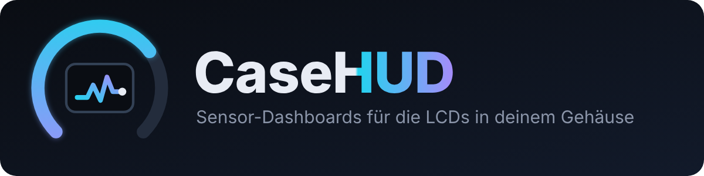
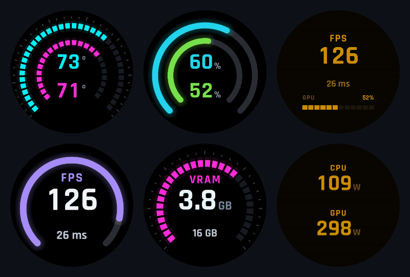
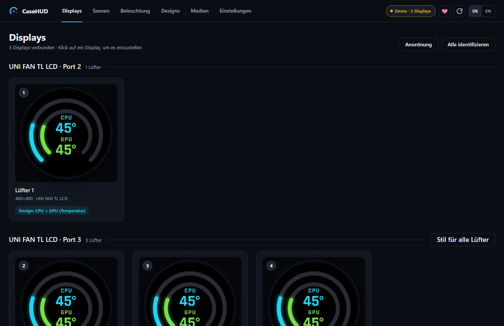
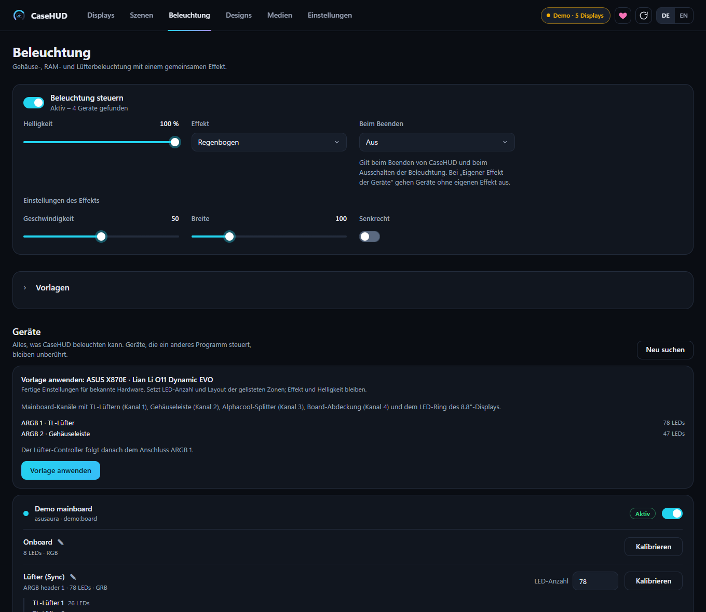
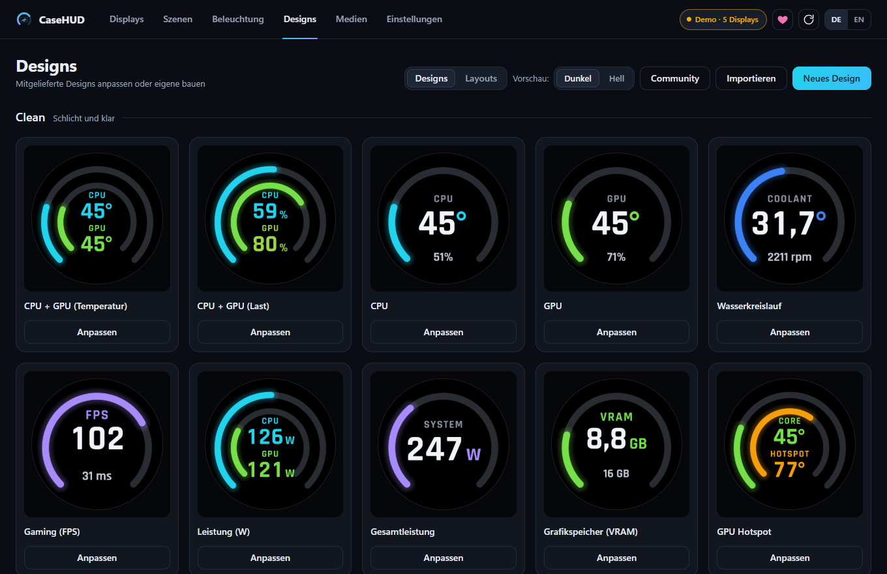
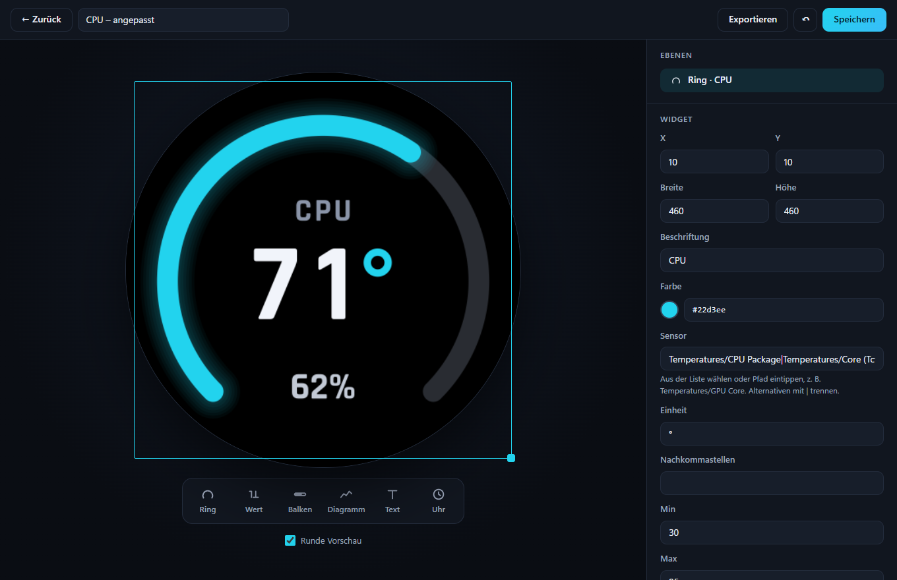
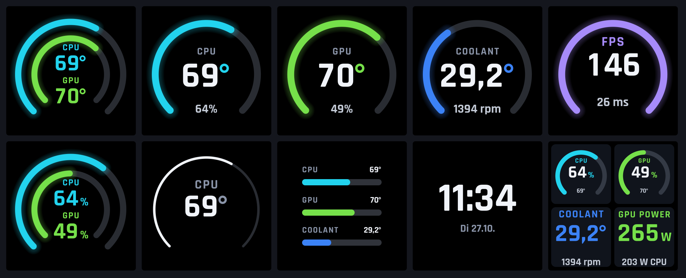
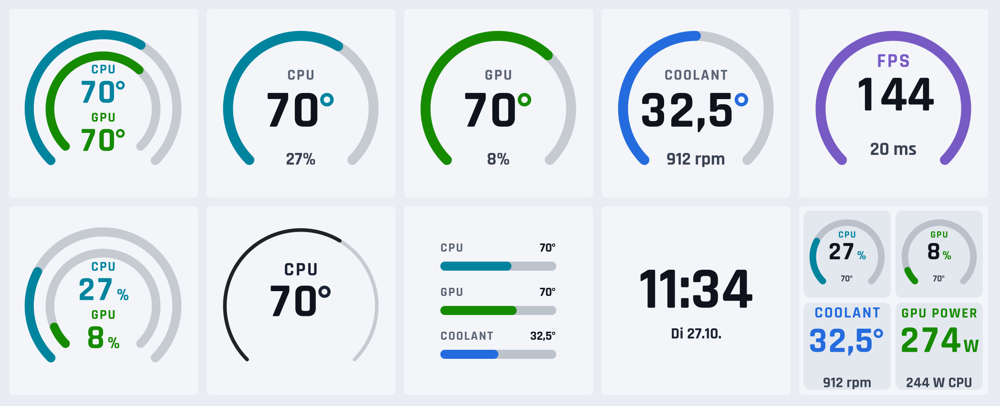
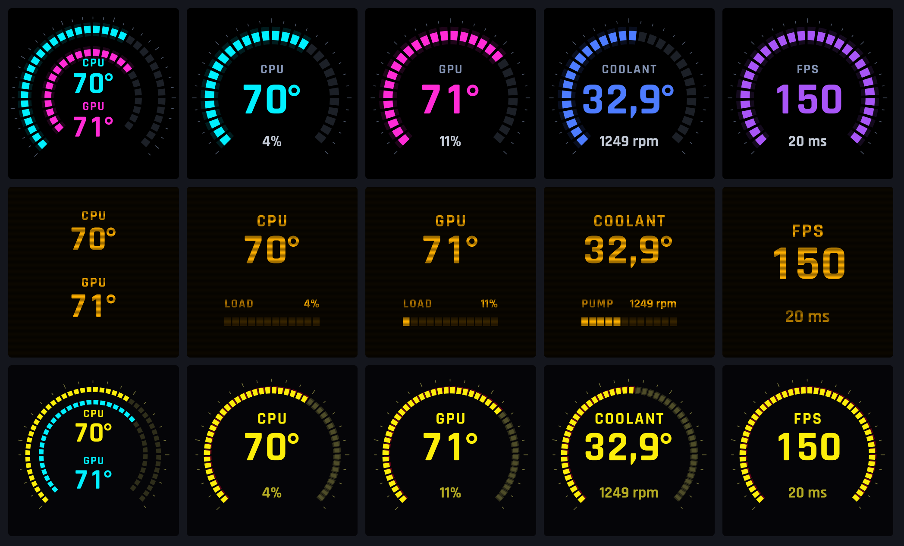

<p align="center"></p>

<p align="center">
  <b>Das Head-up-Display für dein Gehäuse.</b><br>
  Kostenlose Open-Source-Software für die LCDs in deinem PC – Lüfter, Pumpenköpfe, Case-Screens.<br>
  CPU-/GPU-Last, Temperaturen, Werte der Wasserkühlung, eigene Designs, Bilder, GIFs und Videos – lokal, ohne Cloud und ohne Konto.
</p>

<p align="center">
  <a href="#deutsch">Deutsch</a> · <a href="#english">English</a>
</p>

> **Version 1.0** – auf echter Hardware getestet mit **UNI FAN TL LCD** (Lüfter) und **Universal Screen 8.8"**.
> Die Treiber für weitere Geräte (z. B. **HydroShift / Galahad II LCD**) sind umgesetzt, aber experimentell –
> Tester sind willkommen.
>
> CaseHUD ist ein universelles Tool für PC-Displays; weitere Hersteller und Geräte sollen folgen.
>
> _CaseHUD ist kein offizielles Produkt von Lian Li oder anderen Herstellern und nicht mit ihnen verbunden. Markennamen dienen nur zur Beschreibung der Kompatibilität._

<p align="center"></p>

<p align="center"></p>

---

## Deutsch

### Warum CaseHUD?

CaseHUD ist aus Frust entstanden. Die Originalsoftware der Hersteller war mir für meine LCD-Lüfter zu
unflexibel, und andere Lösungen boten die Ansteuerung der Displays nur gegen ein kostenpflichtiges
Abo an. Ich wollte einfach sehen, was in meinem PC passiert: CPU- und
GPU-Last, Temperaturen, die Wassertemperatur meiner Wakü und beim Zocken die FPS.

Also hab ich es selbst gebaut. Das Ziel von CaseHUD: **kostenlos, offen und mehr können** als die
bisherigen Lösungen. Mehr Designs, mehr Sensoren, volle Kontrolle für dich, ohne Cloud und ohne Konto.

### Funktionen

- **Alle LCDs auf einen Blick:** Jeder LCD-Lüfter bzw. Pumpenkopf mit Live-Vorschau
- **Pro Display wählbar:** Sensor-Design, Bild, GIF oder Video, dazu Helligkeit und Drehung
- **Dunkel oder Hell** pro Display, die Farben werden für helle Hintergründe automatisch angepasst
- **Lüfter-Set mit einem Klick:** CPU, GPU und Wasser auf drei LCD-Lüfter im gleichen Look
- **Designs teilen:** als JSON exportieren und importieren – auch von einer KI geschriebene Designs
- **Eigene Designs** im Editor: Ringe mit Leuchteffekt, Werte, Balken, Diagramme, Text und Uhr per Drag & Drop
- **Über 30 fertige Designs** in vier Sets (Clean, Neon, Retro, Cyberpunk): CPU + GPU (Temperatur oder Last),
  Gaming mit FPS und Latenz, Wasserkreislauf, Leistung in Watt, Gesamtleistung, VRAM, GPU-Hotspot
- **Rechnen mit Sensoren:** z. B. `Powers/Package + Powers/GPU Package` für die Gesamtleistung
- **Alle Sensoren**, die LibreHardwareMonitor kennt: CPU (Intel/AMD), GPU (NVIDIA/AMD/Intel),
  Mainboard, Wassertemperatur, Pumpe, Durchfluss, Aquacomputer …
- **Ohne Streit mit Herstellersoftware:** Die Displays werden angesteuert, ohne Lüfter und Pumpe anzufassen.
  Erkennt CaseHUD Programme, die dieselben Displays oder LEDs ansteuern, fragt es, ob es sie beenden
  soll (nur auf Klick, nur bekannte Programme)
- **Start- und Ruhebild der Lüfter-LCDs:** Nach der Zustimmung zum Haftungsausschluss schreibt CaseHUD einmalig sein Logo
  als Start- und Ruhebild in jede UNI FAN TL LCD (**dauerhaft im Display**; standardmäßig an, abschaltbar unter
  Einstellungen → Geräte). Eine Seriennummer für Displays ohne eine vergibt CaseHUD nur, wenn du es dort einschaltest
  (standardmäßig aus); vorhandene Seriennummern werden nie geändert
- **Beleuchtung (optional, standardmäßig aus):** Tab „Beleuchtung“ für den UNI FAN TL Controller (Lüfter-LEDs),
  ARGB-Anschlüsse und Onboard-Licht von ASUS-Mainboards, RAM-Riegel (nur über die optionale SMBus-Brücke des
  Sensor-Dienstes, `docs/SMBUS-BRIDGE.md`) und den LED-Rahmen des Universal Screen 8.8". Es wird nichts gesendet,
  bis du die Beleuchtung einschaltest; Hinweise und Risiken (Flash-Verschleiß beim Controller) stehen im Tab
- **Firmware-Anzeige:** Die Firmware-Versionen der Geräte werden angezeigt; eine optionale Prüfung auf neuere
  Versionen (standardmäßig aus) liest nur die Download-Seite des Herstellers. CaseHUD installiert keine Firmware
- **Läuft im Hintergrund** mit Tray-Icon, auf Wunsch mit Windows-Autostart
- **Breite Displays aufteilen:** Das Universal Screen 8.8" (1920×480) lässt sich in Felder aufteilen
  („Aufteilung“, z. B. 4, 3, 2 oder gemischte Layouts). Jedes Feld ist ein virtuelles Display mit eigenem
  Design, Theme und Hintergrund; dazu breite Designs und Montage hochkant (90°/270°)
- **Szenen und Automatik:** Szenen speichern ein komplettes Setup und bleiben getrennt von der Rotation.
  Regeln schalten automatisch eine Szene, solange ein Spiel läuft, und danach zurück
- **Spielerkennung** per FPS-Messung (Vordergrund, Vollbild), mit eingebauter Liste normaler Programme
  und eigener Ignorierliste („Kein Spiel“)
- Setup mit Sensor-Dienst oder portable ZIP, kein Treibertausch

Der Tab „Beleuchtung“ (hier im Demo-Modus mit simulierten Geräten):

<p align="center"></p>

<p align="center">
  
  
</p>

### Designs in Dunkel und Hell

Jedes Design gibt es pro Display wahlweise **dunkel** oder **hell** – ideal für weiße Builds.

<p align="center"></p>
<p align="center"></p>

Dazu weitere **Design-Sets**: **Neon** (futuristisches HUD mit Segmenten und Leuchteffekt),
**Retro** (Bernstein-Röhrenmonitor mit LED-Balken und Scanlines) und **Cyberpunk** (gelb-cyanfarbene Segmente). Der Lüfter-Set-Knopf setzt auf Wunsch
alle Lüfter eines Ports auf denselben Stil.

<p align="center"></p>

### Unterstützte Geräte

| Gerät | Auflösung | Anbindung | Status |
|---|---|---|---|
| UNI FAN TL LCD | 400×400 | HID | ✅ getestet |
| Universal Screen 8.8" | 1920×480 | WinUSB | ✅ getestet |
| HydroShift LCD / Galahad II LCD / Galahad II LCD V2 | 480×480 | HID | experimentell, Tester gesucht |
| Vision-M 9.2" | 1920×464 | WinUSB | experimentell, Tester gesucht |
| Lancool 207 Digital | 1472×720 | WinUSB | experimentell, Tester gesucht |
| SL V3 LCD / TL V2 LCD (per USB) | 400×400 | WinUSB | experimentell, Tester gesucht |
| TL Flex LCD / SL INF Flex LCD | 400×400 | WinUSB | experimentell, Tester gesucht |
| EdgeHub Advanced (nur Temperatursensoren lesen) | – | HID | experimentell, Tester gesucht |
| HydroShift II LCD | div. | WinUSB | geplant |

Hängt der 8.8" im Monitor-Modus (z. B. nach der Herstellersoftware), bietet CaseHUD einen „Zurückholen“-Knopf an.

**Experimentelle Geräte** sind noch auf keiner echten Hardware bestätigt. CaseHUD spricht sie erst an,
wenn du sie unter Einstellungen → Geräte freigibst (standardmäßig aus, einzeln abschaltbar); ihre
Karten tragen das Kennzeichen „experimentell“. Die Treiber sind in `docs/DRIVERS.md` beschrieben.

Du hast eins der Geräte? Tester sind sehr willkommen! Eröffne ein Issue mit Gerätename und
USB-VID:PID (Geräte-Manager → Eigenschaften → Details → Hardware-IDs), am einfachsten über das
Formular „Hardware-Testbericht“.

### Netzwerk und Datenschutz

CaseHUD funktioniert ohne Cloud und ohne Konto. Das ist alles, was das Programm im Netz tut:

| Funktion | Ziel | Standard | Wann |
|---|---|---|---|
| Update-Hinweis | `api.github.com` (neueste Release-Version) | an, abschaltbar | beim Start und danach täglich |
| Community-Galerie / Library | `raw.githubusercontent.com/kewe87/casehud-library` | nur auf Abruf | wenn du die Galerie bzw. die Licht-Presets öffnest oder aktualisierst |
| Firmware-Prüfung | Download-Seite auf `lian-li.com` (es wird nur die Seite gelesen) | aus | einmal pro Start, nur wenn eingeschaltet; der Hersteller sieht dabei deine IP-Adresse |
| AWTRIX-Suche | UDP 4210/4211 und HTTP im lokalen Netz | nur auf Abruf | wenn du nach Uhren suchst |
| Lokale API und MCP | nur `127.0.0.1`, mit Token | aus | nur wenn eingeschaltet (Einstellungen → Schnittstellen) |

Es gibt keine Telemetrie. Mehr dazu in [SECURITY.md](SECURITY.md).

### Getestete Hardware

Welche Hardware CaseHUD ansteuert und womit es erfolgreich getestet wurde. Die Liste wächst mit der
Community: Wer weitere Hardware testet, kann sie per Issue melden, sie wird dann in der passenden
Tabelle ergänzt.

**Lüfter und Controller**

| Hardware | Funktionen | Getestet von |
|---|---|---|
| Lian Li UNI FAN TL LCD 120 (TLC12) | Display, Anordnung | Entwickler |
| Lian Li UNI FAN TL LCD Reverse 120 (TLFC12) | Display, Anordnung | Entwickler |
| Lian Li UNI FAN TL Reverse 120 (TLF12) | Anordnung, Beleuchtung | Entwickler |
| Lian Li UNI FAN TL Controller (2. Generation) | Topologie, Beleuchtung | Entwickler |

**Displays**

| Hardware | Funktionen | Getestet von |
|---|---|---|
| Lian Li Universal Screen 8.8" (1920×480) | Display, Aufteilungen, Icons, hochkant | Entwickler |
| Ulanzi TC002 mit AWTRIX NG | Netzwerksuche, Anzeige | Entwickler |

**Mainboards**

| Hardware | Funktionen | Getestet von |
|---|---|---|
| ASUS ROG STRIX X870E-E GAMING WIFI | Sensoren inkl. T_Sensor (Wassertemperatur), Beleuchtung (Onboard, ARGB) | Entwickler |

**Arbeitsspeicher**

| Hardware | Funktionen | Getestet von |
|---|---|---|
| G.Skill Trident Z5 RGB DDR5-8000 CL40 (F5-8000J4048G24G) | Beleuchtung über die SMBus-Brücke des Sensor-Dienstes | Entwickler |

**Wasserkühlung**

| Hardware | Funktionen | Getestet von |
|---|---|---|
| Alphacool Core Distro Plate für Lian Li O11 Dynamic EVO | Pumpen- und Kühlmittelsensoren, Beleuchtung (in Arbeit) | Entwickler |
| Alphacool Core GeForce RTX 5080 Solid/AMP mit Backplate (für Zotac) | Beleuchtung (in Arbeit) | Entwickler |
| Alphacool Apex 1 CPU Block ARGB, AMD AM5 | Beleuchtung (in Arbeit) | Entwickler |

**Gehäuse**

| Hardware | Funktionen | Getestet von |
|---|---|---|
| Lian Li O11 Dynamic EVO | Anordnung, Layout der Beleuchtung | Entwickler |

**Betriebssystem**

| System | Funktionen | Getestet von |
|---|---|---|
| Windows 11 | Installer, Sensor-Dienst, Autostart | Entwickler |

### Schnellstart

1. Unter [Releases](../../releases) **`CaseHUD-Setup-x.y.z.exe`** herunterladen und ausführen.
   Das Setup installiert in einem Schritt alles Nötige: CaseHUD, den **Sensor-Dienst**
   (LibreHardwareMonitor ist eingebaut – nichts extra zu installieren), den Hardware-Treiber
   PawnIO und die Berechtigung für die FPS-Messung.
2. **Herstellersoftware für die Displays beenden**, sonst streiten sich zwei Programme um die LCDs.
   CaseHUD erkennt solche Programme und fragt, ob es sie für dich beenden soll.
3. CaseHUD startet nach dem Setup automatisch und zeigt alle gefundenen LCDs.
   Schließt du das Fenster, läuft die Anzeige im Tray weiter.

Ohne Installation geht's mit dem **Portable-Zip**; die Sensoren kommen dann von einem laufenden
LibreHardwareMonitor (*Options → Remote Web Server → Run*).

Voraussetzungen: Windows 10/11 x64 (nur Windows) und die WebView2-Runtime (bei Windows 11 dabei).
Die Programme sind noch nicht code-signiert, Windows SmartScreen kann warnen; Prüfsummen und Signatur
beschreibt [SECURITY.md](SECURITY.md).

Für Videos wird **ffmpeg** benötigt (`winget install ffmpeg` oder `ffmpeg.exe` neben die Exe legen).
Bilder und GIFs funktionieren ohne.

### Installation, Deinstallation und Datenordner

- **Datenordner:** `%APPDATA%\casehud` (Einstellungen, Designs, Medien); mit `--data` lässt sich ein anderer
  Ordner wählen. Er bleibt bei der Deinstallation erhalten.
- **Das Setup installiert:** CaseHUD nach `C:\Program Files\CaseHUD`, den Dienst `CaseHUDSensors` (läuft als SYSTEM),
  den Treiber PawnIO (nur falls noch nicht vorhanden), PresentMon für die FPS-Messung und eine Firewall-Regel
  für die AWTRIX-Suche (UDP 4211, nur private Netzwerke). Optional: Autostart und die FPS-Berechtigung
  (Mitgliedschaft in der Windows-Gruppe „Leistungsprotokollbenutzer“ / Performance Log Users; danach ab- und anmelden).
- **Die Deinstallation entfernt** Programm, Dienst, Firewall-Regel und den Autostart-Eintrag des deinstallierenden
  Kontos. **Es bleiben zurück:** der Datenordner, `C:\ProgramData\CaseHUD` (nur für die optionale `sensors.json`
  der SMBus-Brücke; für normale Benutzer nur lesbar), der Treiber PawnIO (eigenständig, ggf. von anderer Software
  genutzt; unter „Apps“ separat entfernbar) und die Gruppenmitgliedschaft. Dauerhafte Schreibvorgänge im Gerät,
  etwa das Startbild der Lüfter, bleiben im Gerät.
- **Update:** das neue Setup einfach darüber installieren.

**Kommandozeile der GUI (`CaseHUD.exe`):**

| Option | Wirkung |
|---|---|
| `--demo` | simulierte LCDs und Sensoren, keine Hardware nötig |
| `--minimized` | startet im Tray, ohne das Fenster zu öffnen (der Autostart nutzt das) |
| `--background` | wie `--minimized`; läuft CaseHUD schon, beendet sich der zweite Start still, ohne das Fenster zu zeigen |
| `--no-tray` | kein Tray-Symbol (Shells ohne Taskleiste); das Fenster öffnet die API oder ein zweiter Start |
| `--port N` | Port der Oberfläche auf 127.0.0.1 (Standard: zufällig) |
| `--data ORDNER` | anderer Datenordner |
| `--set-api=on` / `off` | schaltet die API in den Einstellungen um und beendet sich (vom Installer genutzt) |

### Roadmap

**1.0 – Erstes Release**
- Unterstützte Displays (Hersteller Lian Li): UNI FAN TL LCD – auf echter Hardware validiert; Universal Screen 8.8" (1920×480, WinUSB, Querformat oder hochkant)
- Experimentell (standardmäßig aus, Einstellungen → Geräte): HydroShift LCD, Galahad II LCD, Vision-M 9.2", Lancool 207 Digital, SL V3 / TL V2 LCD, TL/SL-INF Flex LCD; EdgeHub Advanced als Temperatursensor
- Rotation, Szenen und Automatik (Spiel erkannt → Szene), animierte Hintergründe, Uhren in allen Design-Sets, weiche Animationen
- **AWTRIX**-Pixeluhren als Netzwerk-Display: Ulanzi TC001 (AWTRIX 3 oder AWTRIX NG) und TC002 (AWTRIX NG), mit Netzwerksuche und eigenen Icons pro Modell
- Optionale **MCP-Schnittstelle** (standardmäßig aus): KI-Assistenten lesen Sensoren und entwerfen Designs
- Lokale **API** für andere Programme wie CouchHUD (Einstellungen → Schnittstellen, standardmäßig aus; siehe `docs/API.md`)
- Community-Galerie für Designs
- Setup mit Sensor-Dienst, sauberes Update und Deinstallieren
- Hotplug, Standby und automatische Wiederverbindung der Displays; Displays aus bei Bildschirmschoner
- Erkennung von Herstellersoftware, die dieselben Geräte ansteuert, mit Beenden-Dialog (nur auf Klick)
- Optionale **Beleuchtung** (Tab „Beleuchtung“, standardmäßig aus): TL Controller, Mainboard-ARGB, RAM über die SMBus-Brücke, 8.8"-Rahmen
- Anzeige der Geräte-Firmware, optionale Prüfung auf neue Firmware (standardmäßig aus)
- Ersteinrichtung: Sensoren prüfen, Lüfter erkennen, Design pro Lüfter vorschlagen
- Signierte Prüfsummen, Diagnose-Export und Issue-Vorlagen für Geräte-Tests

**1.1 – Beleuchtung ausbauen** (Ideen, keine Zusagen)
- Gehäuse-Skizze und Layout-Editor für die LEDs, weitere Geräte und Controller
- Bildschirm- und Audio-Effekte

**Ideen für später – nach Nachfrage**
- Alarme (Display pulsiert bei kritischer Temperatur), Zeitpläne, abgeleitete Sensoren wie ΔT
- Neue Widgets (Laufwerke, Netzwerk), „Now Playing“, Home Assistant / MQTT, eigene HTTP/JSON-Quellen
- Weitere Hersteller und Display-Typen – nur mit Testern aus der Community, die die Hardware besitzen

Du hast ein Display, das fehlt? Eröffne ein Issue mit Gerätename und USB-VID:PID – mit Tester geht's schneller.

### Kommandozeile

Für Skripte und zur Fehlersuche liegt zusätzlich `casehud-cli.exe` bei (das GUI ist `CaseHUD.exe`):

```powershell
.\casehud-cli.exe devices                 # gefundene LCDs anzeigen
.\casehud-cli.exe sensors                 # alle Sensoren von LibreHardwareMonitor anzeigen
.\casehud-cli.exe run --mock              # Testanzeige mit simulierten Werten auf allen LCDs
.\casehud-cli.exe preview --out test.png  # ein Bild mit Live-Werten rendern
```

### Sensoren in Designs

Ein Sensor wird über seinen Pfad in LibreHardwareMonitor angesprochen, z. B.
`Temperatures/GPU Core`. Mehrere Alternativen trennt man mit `|`, die erste vorhandene wird genommen:
`Temperatures/CPU Package|Temperatures/Core (Tctl/Tdie)` funktioniert dadurch mit Intel und AMD.
Dedizierte Grafikkarten haben Vorrang vor der integrierten Grafik der CPU.

**ASUS-Boards mit T_Sensor:** Der mitgelieferte Sensor-Dienst enthält bereits den Fix für den
Wassertemperatur-Header der ROG STRIX X870E-E/-H und X870-F (in LibreHardwareMonitor selbst noch offen).

### Selbst bauen

```bash
go test ./...
GOOS=windows GOARCH=amd64 go build -o casehud.exe ./cmd/casehud
GOOS=windows GOARCH=amd64 go build -ldflags "-H windowsgui" -o CaseHUD.exe ./cmd/casehud-gui
go run ./cmd/casehud-gui --demo       # GUI mit simulierten LCDs, ohne Hardware
```

Releases baut GitHub Actions (`.github/workflows/release.yml`): Entweder einen Tag `vX.Y.Z` pushen oder den
Workflow „Release“ manuell mit dem Tag als Eingabe starten. Heraus kommen Setup und portable ZIP für
**Windows x64** samt signierten Prüfsummen unter Releases. Andere Plattformen werden nicht gebaut.

---

## English

**Why CaseHUD?** It started out of frustration: the manufacturers' own software was too inflexible for my
LCD fans, and other options put LCD support behind a paid subscription. I just
wanted to see what's going on in my PC: CPU/GPU load, temperatures, my loop's coolant temperature
and FPS while gaming. So I built it myself. CaseHUD's goal: **free, open and more capable** than
the existing options, with more designs, more sensors and full control, no cloud and no account.

**CaseHUD – the head-up display for your PC case.** Free, open-source software for the LCD screens
in your PC (fans, pump heads, case screens; more vendors and devices planned). Show CPU/GPU load,
temperatures, coolant and pump data, custom designs, images, GIFs and videos – local,
no cloud, no account. It drives the displays without touching fans or pump; if it finds vendor
software that controls the same devices, it asks whether to close it (on your click only).

Version 1.0 is tested on real **UNI FAN TL LCD** fans and the **Universal Screen 8.8"**. It ships 30+ designs in four
sets (Clean, Neon, Retro, Cyberpunk): CPU + GPU temperature or load, gaming with FPS and latency, coolant loop,
power in watts, total power, VRAM and GPU hotspot – each in dark and light. Also included: scenes, automation
(a game starts, a scene switches), rotation, animated backgrounds, AWTRIX pixel clocks, a local API and an
optional MCP interface (both off by default).

**Permanent writes to devices.** After you accept the disclaimer, CaseHUD writes its logo once into each UNI FAN TL LCD
as start and idle image (permanent, on by default, switchable under Settings → Devices). Assigning a serial number to
displays without one is optional and off by default; existing serial numbers are never changed.

**Lighting (optional, off by default).** The "Beleuchtung" (lighting) tab drives the UNI FAN TL controller, ARGB headers
and onboard lighting of ASUS mainboards, RAM sticks (only through the optional SMBus bridge of the sensor service,
`docs/SMBUS-BRIDGE.md`) and the LED frame of the Universal Screen 8.8". Nothing is sent until you switch it on.
Firmware versions of the devices are shown; an optional firmware check (off by default) only reads the manufacturer's
download page. CaseHUD never installs firmware.

### Quick start

1. Download `CaseHUD-Setup-x.y.z.exe` from the [releases](../../releases) and run it. It installs CaseHUD, the sensor
   service (LibreHardwareMonitor built in), the PawnIO driver and the FPS capture permission in one go.
2. Close any vendor software that controls the displays (CaseHUD detects it and offers to close it).
3. CaseHUD starts after the setup and shows all LCDs it found. Closing the window keeps it running in the tray.

Requires Windows 10/11 x64 and the WebView2 runtime (included in Windows 11). The executables are not code-signed
yet, so SmartScreen may warn; see [SECURITY.md](SECURITY.md) for checksums and signature. Videos need ffmpeg
(`winget install ffmpeg`). A portable ZIP works without installing, with sensors from a running LibreHardwareMonitor
(*Options -> Remote Web Server -> Run*).

### Supported devices

| Device | Resolution | Link | Status |
|---|---|---|---|
| UNI FAN TL LCD | 400x400 | HID | tested |
| Universal Screen 8.8" | 1920x480 | WinUSB | tested |
| HydroShift LCD / Galahad II LCD / Galahad II LCD V2 | 480x480 | HID | experimental, testers wanted |
| Vision-M 9.2" | 1920x464 | WinUSB | experimental, testers wanted |
| Lancool 207 Digital | 1472x720 | WinUSB | experimental, testers wanted |
| SL V3 LCD / TL V2 LCD (USB) | 400x400 | WinUSB | experimental, testers wanted |
| TL Flex LCD / SL INF Flex LCD | 400x400 | WinUSB | experimental, testers wanted |
| EdgeHub Advanced (temperature sensors only) | - | HID | experimental, testers wanted |
| HydroShift II LCD | various | WinUSB | planned |

Experimental devices are not confirmed on real hardware. CaseHUD only talks to them after you enable them under
Settings -> Devices (off by default); see `docs/DRIVERS.md`. Own one? Open an issue with the device name and USB VID:PID
(use the "Hardware test report" form). If an 8.8" bar is stuck in monitor mode, CaseHUD offers a "Bring back" button.
Wide displays can be split into fields that act as virtual displays, bars can be mounted upright, and automation rules
switch to a saved scene while a game runs.

### Network and privacy

No cloud, no account, no telemetry. This is everything CaseHUD does on the network:

| Feature | Target | Default | When |
|---|---|---|---|
| Update notice | `api.github.com` (latest release version) | on, can be switched off | at start, then daily |
| Community gallery / library | `raw.githubusercontent.com/kewe87/casehud-library` | on demand only | when you open or refresh the gallery or the light presets |
| Firmware check | download page on `lian-li.com` (page is only read) | off | once per start, only if enabled; the manufacturer sees your IP address |
| AWTRIX search | UDP 4210/4211 and HTTP in the local network | on demand only | when you search for clocks |
| Local API and MCP | `127.0.0.1` only, token protected | off | only when enabled (Settings -> Interfaces) |

See also [SECURITY.md](SECURITY.md).

### Installation, uninstalling and data folder

- **Data folder:** `%APPDATA%\casehud` (settings, designs, media); use `--data` for another folder. It is kept when you uninstall.
- **The setup installs** CaseHUD to `C:\Program Files\CaseHUD`, the `CaseHUDSensors` service (runs as SYSTEM), the PawnIO
  driver (only if missing), PresentMon for FPS measurement and a firewall rule for the AWTRIX search (UDP 4211, private
  networks only). Optional: autostart and the FPS permission (membership in the Windows group "Performance Log Users";
  sign out and in afterwards).
- **Uninstalling removes** the program, the service, the firewall rule and the autostart entry of the uninstalling account.
  **Left behind:** the data folder, `C:\ProgramData\CaseHUD` (only holds the optional `sensors.json` of the SMBus bridge;
  read-only for normal users), the PawnIO driver (independent, may be used by other software; remove it separately under
  Apps) and the group membership. Permanent writes to devices, such as the fans' start image, stay in the device.
- **Updating:** run the new setup over the old install.

**GUI command line (`CaseHUD.exe`):** `--demo` (simulated LCDs and sensors), `--minimized` (start in the tray),
`--background` (like `--minimized`; if CaseHUD already runs, exit silently), `--no-tray` (no tray icon), `--port N`
(GUI port on 127.0.0.1, default random), `--data FOLDER`, `--set-api=on|off` (switch the API, then exit; used by the installer).

### Build

```bash
go test ./...
GOOS=windows GOARCH=amd64 go build -ldflags "-H windowsgui" -o CaseHUD.exe ./cmd/casehud-gui
go run ./cmd/casehud-gui --demo       # GUI with simulated LCDs, no hardware needed
```

Releases are built by GitHub Actions: push a tag `vX.Y.Z` or start the "Release" workflow manually with the tag as input.
The result is a setup and a portable ZIP for **Windows x64** with signed checksums. Other platforms are not built.
The CLI (`casehud-cli.exe`: `devices`, `sensors`, `run --mock`, `preview --out test.png`) and sensor paths are described in the German section.

**Tested hardware:** see the tables in the German section above ("Getestete Hardware"). The list grows with the
community: report hardware you tested in an issue. Issues and pull requests in English are welcome.

---

## Credits

Drittanbieter-Komponenten und ihre Lizenzen: [THIRD_PARTY_NOTICES.md](THIRD_PARTY_NOTICES.md).

## Lizenz / License

Copyright © 2026 **kewe87**

Dieses Programm ist freie Software unter der **GNU General Public License v3.0**
([LICENSE](LICENSE)). Du darfst es nutzen, verändern und weitergeben – Forks und
Weiterentwicklungen müssen aber ebenfalls unter der GPL-3.0 offen bleiben und den
Copyright-Hinweis „kewe87“ behalten.

Free software under the GPL-3.0: forks and derivatives must stay open source under
the same license and keep the copyright notice.

## Haftungsausschluss / Disclaimer

### Deutsch

CaseHUD ist kostenlose Open-Source-Software unter der GPL-3.0 und wird ohne jegliche Gewährleistung bereitgestellt (siehe GPL-3.0, Abschnitte 15 und 16).

Geräte werden über inoffizielle, unabhängig entwickelte Protokolle angesteuert. Die Nutzung erfolgt auf eigenes Risiko.

Soweit gesetzlich zulässig, wird keine Haftung für Schäden an Hardware oder für Datenverlust übernommen. Die Haftung für Vorsatz, grobe Fahrlässigkeit sowie für die Verletzung von Leben, Körper oder Gesundheit bleibt unberührt.

CaseHUD ist kein offizielles Produkt von Lian Li oder anderen Herstellern und steht in keiner Verbindung zu ihnen. Marken und Produktnamen gehören ihren jeweiligen Inhabern.

CaseHUD installiert einen Sensor-Dienst, der mit Systemrechten läuft, und den Treiber PawnIO zum Auslesen von Sensoren.

Beleuchtung und experimentelle Geräte sind optional und standardmäßig ausgeschaltet.

CaseHUD schreibt sein Logo einmalig als Start- und Ruhebild in unterstützte Lüfter-Displays und vergibt an Displays ohne Seriennummer eine Seriennummer. Beides sind dauerhafte Schreibvorgänge auf dem Gerät; Start- und Ruhebild und Seriennummer lassen sich unter Einstellungen → Geräte abschalten.

### English

CaseHUD is free open-source software under the GPL-3.0 and is provided without any warranty (see GPL-3.0, sections 15 and 16).

Devices are driven through unofficial, independently developed protocols. Use is at your own risk.

To the extent permitted by law, no liability is accepted for hardware damage or data loss. Liability for intent, gross negligence and injury to life, body or health remains unaffected.

CaseHUD is not an official product of Lian Li or any other manufacturer and is not affiliated with them. Trademarks and product names belong to their respective owners.

CaseHUD installs a sensor service that runs with system rights and the PawnIO driver for reading sensors.

Lighting and experimental devices are optional and off by default.

CaseHUD writes its logo once as the start and idle image of supported fan displays and assigns a serial number to displays that have none. Both are permanent writes to the device; both can be switched off under Settings → Devices.
