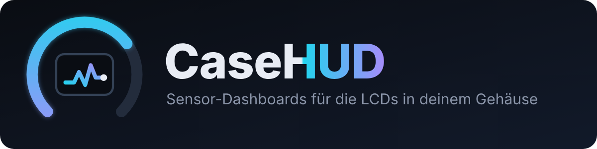
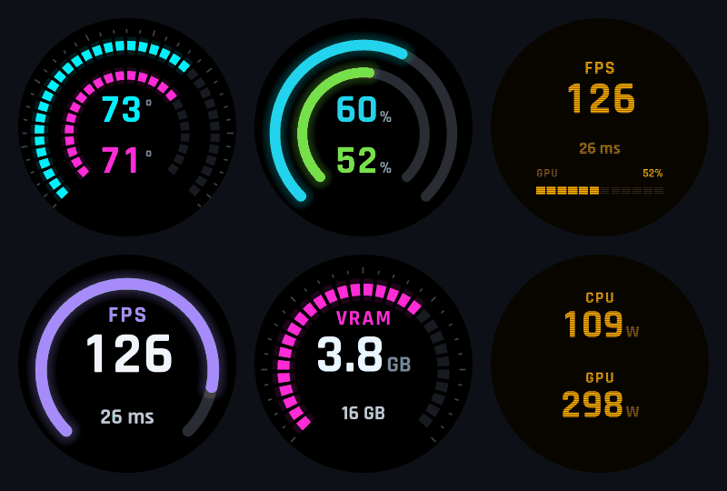
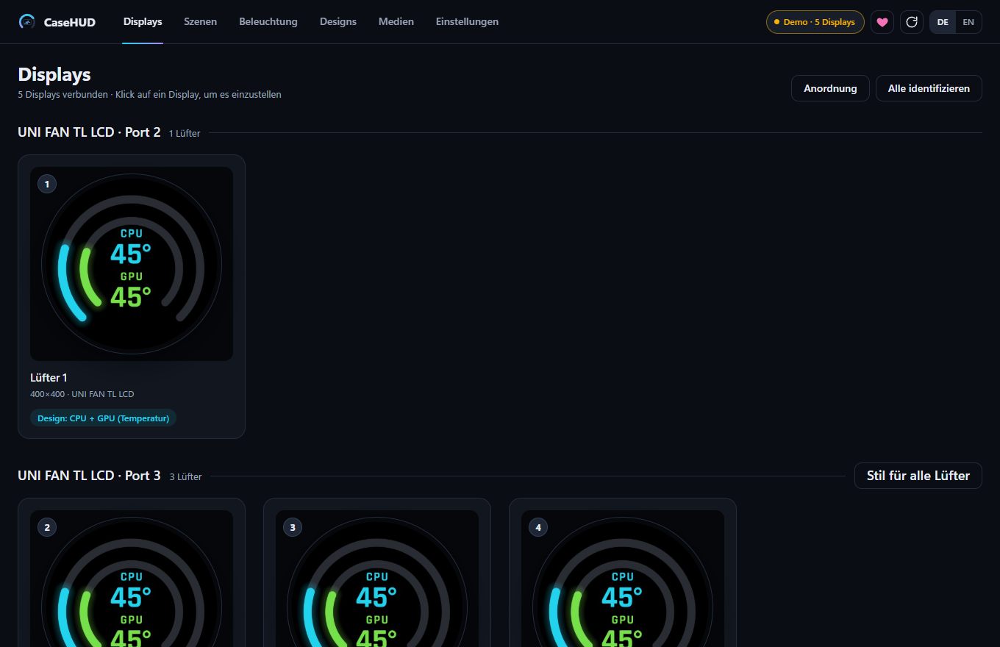
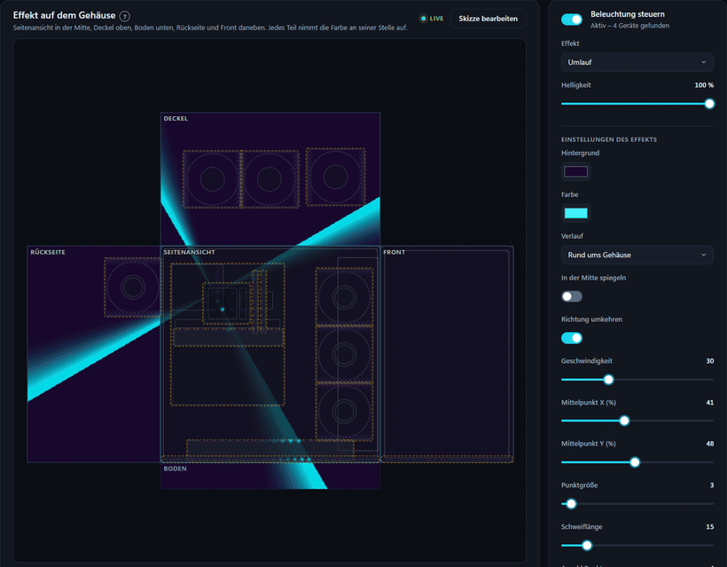
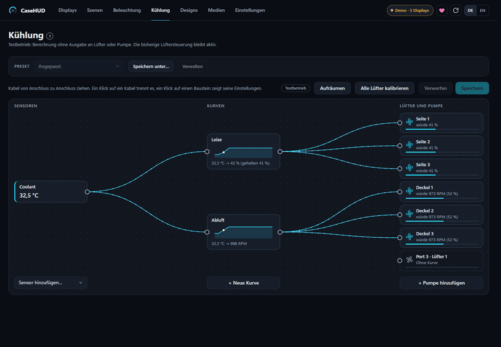
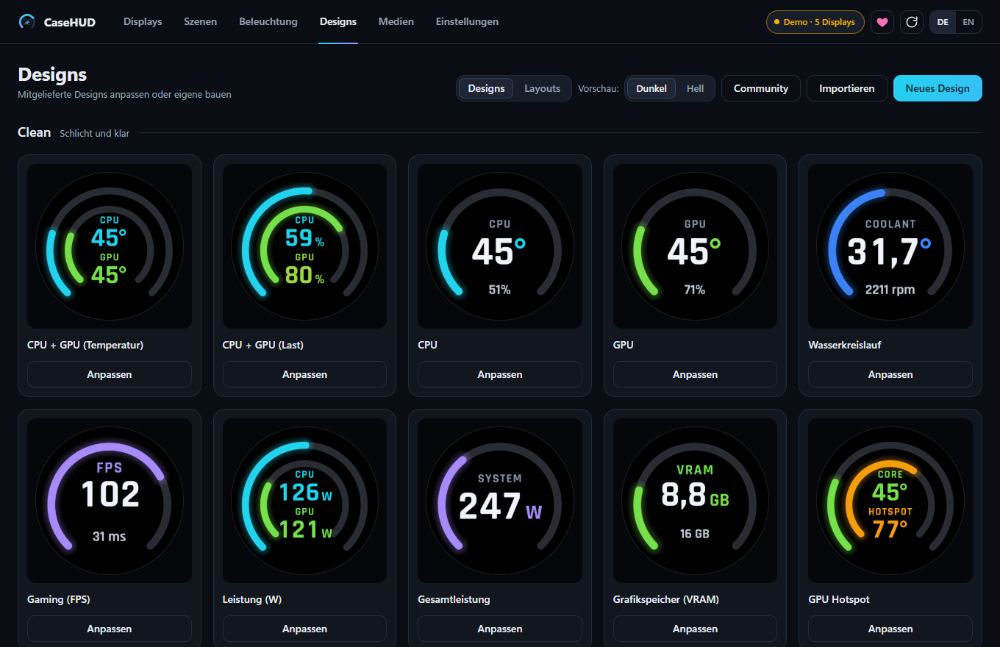
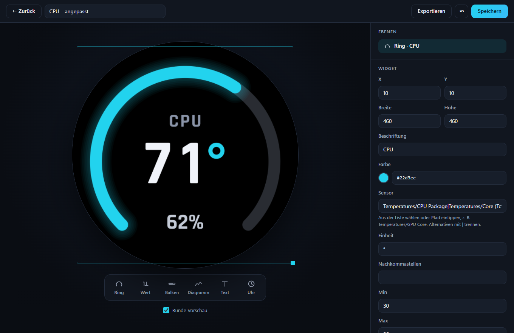
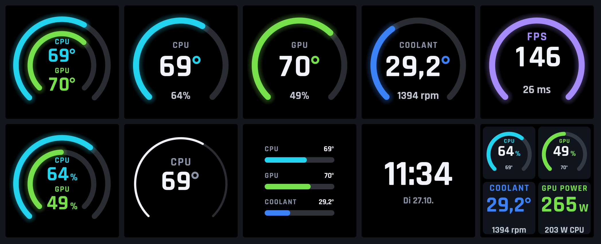
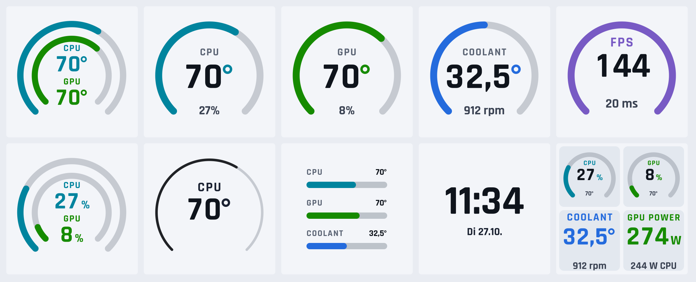
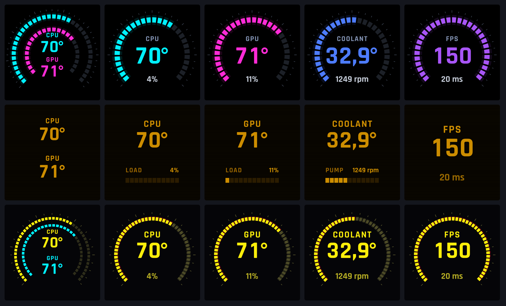

  <b>Das Head-up-Display für dein Gehäuse.</b> 
  Kostenlose Open-Source-Software für die LCDs in deinem PC – Lüfter, Pumpenköpfe, Case-Screens. 
  CPU-/GPU-Last, Temperaturen, Kühlmittel (falls vorhanden), eigene Designs, Bilder, GIFs und Videos – lokal, ohne Cloud und ohne Konto.

  <a href="#deutsch">Deutsch</a> · <a href="#english">English</a> ·
  <a href="docs/handbuch/README.md">Handbuch</a> · <a href="docs/manual/README.md">Manual</a>

> **Version 1.2** – auf echter Hardware getestet mit **UNI FAN TL LCD** (Lüfter) und **Universal Screen 8.8"**.
> Die Treiber für weitere Geräte (z. B. **HydroShift / Galahad II LCD**) sind umgesetzt, aber experimentell – Tester sind willkommen.
>
> _CaseHUD ist kein offizielles Produkt von Lian Li oder anderen Herstellern und nicht mit ihnen verbunden. Markennamen dienen nur zur Beschreibung der Kompatibilität._

---

## Deutsch

CaseHUD ist aus Frust entstanden: Die Originalsoftware der Hersteller war mir für meine LCD-Lüfter zu unflexibel, und andere Lösungen boten die Ansteuerung der Displays nur gegen ein Abo an. Ich wollte sehen, was in meinem PC passiert – Last, Temperaturen, Kühlmittel, beim Zocken die FPS. Also hab ich es selbst gebaut: **kostenlos, offen und mehr können**, mit mehr Designs, mehr Sensoren und voller Kontrolle, ohne Cloud und ohne Konto.

### Funktionen

Die Bedienung steht im **[Handbuch](docs/handbuch/README.md)**.

- **[Displays](docs/handbuch/displays.md):** alle LCDs mit Live-Vorschau; Sensor-Design, Bild, GIF oder Video pro Display, dunkel oder hell. Über 30 Designs in vier Sets (Clean, Neon, Retro, Cyberpunk), Editor für eigene Designs, Teilen per JSON, Community-Galerie, Aufteilung breiter Displays, AWTRIX-Pixeluhren
- **[Beleuchtung](docs/handbuch/beleuchtung.md)** (optional, standardmäßig aus): TL Controller, ASUS-ARGB, RAM (SMBus-Brücke), 8.8"-Rahmen. Aufgeklapptes Gehäuse mit laufendem Effekt, Gehäuse-Skizze und LED-Layout-Editor, Bildschirm-Ambilight und Audio-Visualizer (nur nach Zustimmung)
- **[Kühlung](docs/handbuch/kuehlung.md)** (neu in 1.2): eigene Steuerung der TL-Lüfter am Lüfter-Controller und einer Pumpe (falls vorhanden) als Schaltplan aus Sensoren, Kurven und Ausgängen, manueller Modus, Kalibrierung, Presets. Pumpe nie unter 30 % und nie aus, Alarm, Wächterprozess bei Absturz
- **[Szenen und Automatik](docs/handbuch/szenen.md):** Szenen, Rotation, Szenenwechsel beim Spielen (Spielerkennung per FPS-Messung)
- **[Sensoren](docs/handbuch/sensoren.md):** alles, was LibreHardwareMonitor kennt, mit Rechnen (z. B. `Powers/Package + Powers/GPU Package`)
- **[API und MCP](docs/handbuch/api-mcp.md):** lokale API und MCP-Server (standardmäßig aus), Rechte je Programm, KI-Verbindung per Klick
- Ohne Streit mit Herstellersoftware (Beenden nur auf Klick), Display, Beleuchtung und Kühlung einzeln abschaltbar, Tray und Autostart

  
  

Jedes Design gibt es pro Display **dunkel** oder **hell** – ideal für weiße Builds:

### Schnellstart

1. Unter [Releases](../../releases) **`CaseHUD-Setup-x.y.z.exe`** herunterladen und ausführen. Das Setup installiert CaseHUD, den **Sensor-Dienst** (LibreHardwareMonitor ist eingebaut), den Treiber PawnIO und die Berechtigung für die FPS-Messung.
2. **Herstellersoftware für die Displays beenden**; CaseHUD erkennt solche Programme und fragt, ob es sie schließen soll.
3. CaseHUD startet automatisch und zeigt alle gefundenen LCDs. Schließt du das Fenster, läuft die Anzeige im Tray weiter.

Alternativ die **Portable-ZIP** (Sensoren von einem laufenden LibreHardwareMonitor). Voraussetzungen: Windows 10/11 x64 und WebView2; Videos brauchen **ffmpeg**. Die Programme sind noch nicht code-signiert, SmartScreen kann warnen ([SECURITY.md](SECURITY.md)). Weiter im Handbuch: [Erste Schritte](docs/handbuch/erste-schritte.md), [Kommandozeile](docs/handbuch/kommandozeile.md), [Fehlerbehebung](docs/handbuch/fehlerbehebung.md), [Selbst bauen und Roadmap](docs/handbuch/selbst-bauen.md).

### Unterstützte Geräte

- ✅ **getestet:** UNI FAN TL LCD (400×400, HID), Universal Screen 8.8" (1920×480, WinUSB)
- **experimentell, Tester gesucht:** HydroShift LCD / Galahad II LCD / Galahad II LCD V2 (480×480), Vision-M 9.2", Lancool 207 Digital, SL V3 LCD / TL V2 LCD (USB), TL Flex LCD / SL INF Flex LCD, EdgeHub Advanced (nur Temperatursensoren). **Geplant:** HydroShift II LCD

Experimentelle Geräte spricht CaseHUD erst nach Freigabe unter Einstellungen → Geräte an ([DRIVERS.md](docs/DRIVERS.md)). Du hast eins? Eröffne ein Issue mit Gerätename und USB-VID:PID über das Formular „Hardware-Testbericht“.

### Getestete Hardware

Die Liste wächst mit der Community (Meldung per Issue). Alle bisher vom Entwickler getestet:

- **Lüfter/Controller:** Lian Li UNI FAN TL LCD 120 (TLC12), TL LCD Reverse 120 (TLFC12), TL Reverse 120 (TLF12), UNI FAN TL Controller (2. Generation)
- **Displays:** Lian Li Universal Screen 8.8", Ulanzi TC002 mit AWTRIX NG
- **Mainboard:** ASUS ROG STRIX X870E-E GAMING WIFI (Sensoren inkl. T_Sensor, Beleuchtung)
- **RAM:** G.Skill Trident Z5 RGB DDR5-8000 CL40 (Beleuchtung über die SMBus-Brücke)
- **Wasserkühlung:** Alphacool Core Distro Plate (O11 Dynamic EVO), Core GeForce RTX 5080 (Zotac), Apex 1 CPU Block ARGB AM5 (Beleuchtung in Arbeit)
- **Gehäuse/System:** Lian Li O11 Dynamic EVO, Windows 11

### Netzwerk und Datenschutz

Keine Cloud, kein Konto, keine Telemetrie. Das ist alles, was CaseHUD im Netz tut:

- **Update-Hinweis:** `api.github.com`, beim Start und täglich, abschaltbar. **Update installieren:** nur auf Klick, von `github.com/kewe87/CaseHUD/releases` (signierte Prüfsummen)
- **Community-Galerie/Library:** `raw.githubusercontent.com/kewe87/CaseHUD-Library`, nur auf Abruf
- **Firmware-Prüfung:** Download-Seite auf `lian-li.com`, standardmäßig aus; der Hersteller sieht dabei deine IP-Adresse
- **AWTRIX-Suche:** UDP 4210/4211 und HTTP im lokalen Netz, nur auf Abruf
- **Lokale API und MCP:** nur `127.0.0.1`, mit Token, standardmäßig aus

Mehr dazu in [SECURITY.md](SECURITY.md).

---

## English

**CaseHUD – the head-up display for your PC case.** Free, open-source software for the LCD screens in your PC (fans, pump heads, case screens): CPU/GPU load, temperatures, coolant and pump data (if present), custom designs, images, GIFs and videos – local, no cloud, no account. It started out of frustration with inflexible vendor software and paid subscriptions; the goal is **free, open and more capable**. Version 1.2 is tested on real **UNI FAN TL LCD** fans and the **Universal Screen 8.8"**.

### Features

Usage is described in the **[Manual](docs/manual/README.md)**.

- **[Displays](docs/manual/displays.md):** live preview of all LCDs; sensor design, image, GIF or video per display, dark or light. 30+ designs in four sets (Clean, Neon, Retro, Cyberpunk), design editor, sharing as JSON, community gallery, split wide displays, AWTRIX pixel clocks
- **[Lighting](docs/manual/lighting.md)** (optional, off by default): TL controller, ASUS ARGB, RAM (SMBus bridge), 8.8" frame. Unfolded case with the running effect, case sketch and LED layout editor, screen ambilight and audio visualizer (only after consent; pictures and sound stay in memory)
- **[Cooling](docs/manual/cooling.md)** (new in 1.2): own control of the TL fans on the fan controller and of a pump (if present) as a wiring plan of sensors, curves and outputs, manual mode, calibration, presets. The pump never runs below 30 % and is never switched off; alarm, guard process on crash
- **[Scenes and automation](docs/manual/scenes.md):** scenes, rotation, scene switch while gaming (game detection by FPS measurement)
- **[Sensors](docs/manual/sensors.md)** and **[API and MCP](docs/manual/api-mcp.md):** everything LibreHardwareMonitor knows; local API and MCP server (both off by default), rights per program, AI connection with one click
- Permanent writes to devices (start image, serial number) are optional and off by default; CaseHUD never installs firmware. Display, lighting and cooling can be switched off individually

### Quick start

1. Download `CaseHUD-Setup-x.y.z.exe` from the [releases](../../releases) and run it (CaseHUD, sensor service, PawnIO driver, FPS capture permission).
2. Close any vendor software that controls the displays (CaseHUD detects it and offers to close it).
3. CaseHUD starts after the setup and shows all LCDs it found. Closing the window keeps it running in the tray.

Requires Windows 10/11 x64 and WebView2; videos need ffmpeg. A portable ZIP works with sensors from a running LibreHardwareMonitor. Not code-signed yet, SmartScreen may warn ([SECURITY.md](SECURITY.md)). More: [Getting started](docs/manual/getting-started.md), [Command line](docs/manual/command-line.md), [Troubleshooting](docs/manual/troubleshooting.md), [Building from source and roadmap](docs/manual/building.md).

### Supported devices

Tested: UNI FAN TL LCD, Universal Screen 8.8". Experimental, testers wanted: HydroShift LCD / Galahad II LCD (V2), Vision-M 9.2", Lancool 207 Digital, SL V3 / TL V2 LCD (USB), TL Flex / SL INF Flex LCD, EdgeHub Advanced (temperature sensors only). Planned: HydroShift II LCD. Experimental devices are only addressed after release under Settings → Devices (see [DRIVERS.md](docs/DRIVERS.md)). Own one? Open an issue with the device name and USB VID:PID ("Hardware test report" form).

**Tested hardware:** see [Getestete Hardware](#getestete-hardware) above. Report your own tests in an issue; issues and pull requests in English are welcome.

### Network and privacy

No cloud, no account, no telemetry. Network use: update notice (`api.github.com`, daily, can be switched off) and update install (on click only, signed checksums); community gallery/library (`raw.githubusercontent.com/kewe87/CaseHUD-Library`, on demand); firmware check (`lian-li.com`, off by default, the manufacturer sees your IP address); AWTRIX search (UDP 4210/4211, local network, on demand); local API and MCP (`127.0.0.1` only, token protected, off by default). See [SECURITY.md](SECURITY.md).

---

## Credits

Drittanbieter-Komponenten und ihre Lizenzen: [THIRD_PARTY_NOTICES.md](THIRD_PARTY_NOTICES.md).

## Lizenz / License

Copyright © 2026 **kewe87**. Freie Software unter der **GNU General Public License v3.0** ([LICENSE](LICENSE)): Nutzen, verändern und weitergeben erlaubt; Forks und Weiterentwicklungen müssen unter der GPL-3.0 offen bleiben und den Copyright-Hinweis „kewe87“ behalten. Free software under the GPL-3.0: forks and derivatives must stay open source under the same license and keep the copyright notice.

## Haftungsausschluss / Disclaimer

**Deutsch:** CaseHUD ist kostenlose Open-Source-Software unter der GPL-3.0 und wird ohne jegliche Gewährleistung bereitgestellt (siehe GPL-3.0, Abschnitte 15 und 16). Geräte werden über inoffizielle, unabhängig entwickelte Protokolle angesteuert. Die Nutzung erfolgt auf eigenes Risiko. Soweit gesetzlich zulässig, wird keine Haftung für Schäden an Hardware oder für Datenverlust übernommen. Die Haftung für Vorsatz, grobe Fahrlässigkeit sowie für die Verletzung von Leben, Körper oder Gesundheit bleibt unberührt. CaseHUD ist kein offizielles Produkt von Lian Li oder anderen Herstellern und steht in keiner Verbindung zu ihnen. Marken und Produktnamen gehören ihren jeweiligen Inhabern. CaseHUD installiert einen Sensor-Dienst, der mit Systemrechten läuft, und den Treiber PawnIO zum Auslesen von Sensoren. Beleuchtung und experimentelle Geräte sind optional und standardmäßig ausgeschaltet. Auf Wunsch (standardmäßig aus) schreibt CaseHUD sein Logo einmalig als Start- und Ruhebild in Lüfter-Displays und vergibt an Lüfter-Displays ohne Seriennummer eine Seriennummer. Beides sind dauerhafte Schreibvorgänge auf dem Gerät und lassen sich unter Einstellungen → Geräte ein- und ausschalten.

**English:** CaseHUD is free open-source software under the GPL-3.0 and is provided without any warranty (see GPL-3.0, sections 15 and 16). Devices are driven through unofficial, independently developed protocols. Use is at your own risk. To the extent permitted by law, no liability is accepted for hardware damage or data loss. Liability for intent, gross negligence and injury to life, body or health remains unaffected. CaseHUD is not an official product of Lian Li or any other manufacturer and is not affiliated with them. Trademarks and product names belong to their respective owners. CaseHUD installs a sensor service that runs with system rights and the PawnIO driver for reading sensors. Lighting and experimental devices are optional and off by default. On request (off by default), CaseHUD writes its logo once as the start and idle image of fan displays and assigns a serial number to fan displays that have none. Both are permanent writes to the device and can be switched on and off under Settings → Devices.
